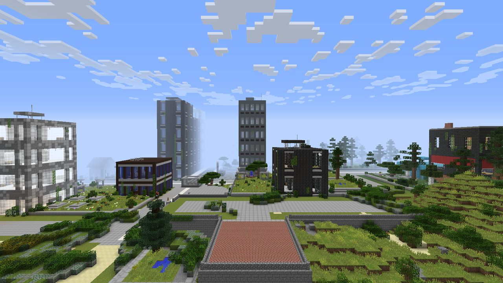
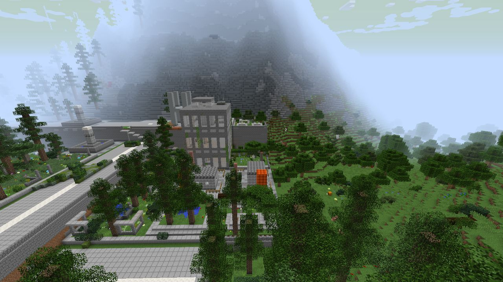
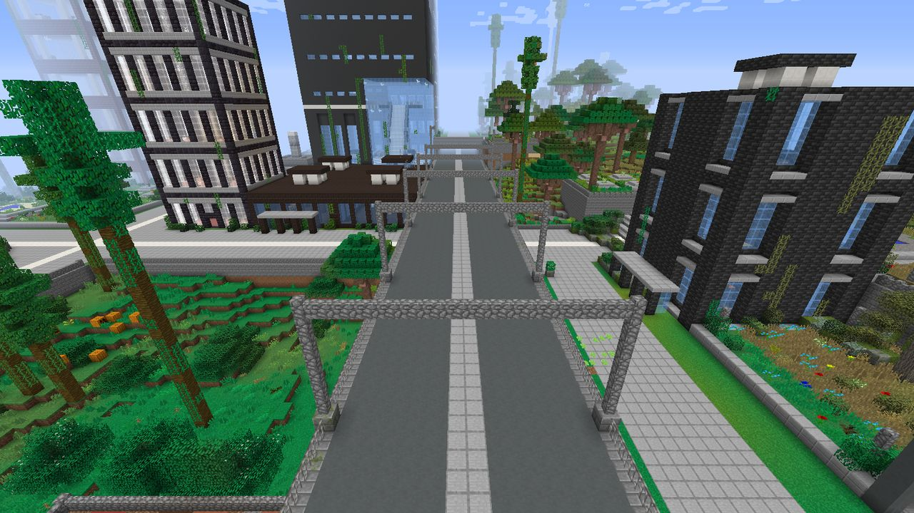
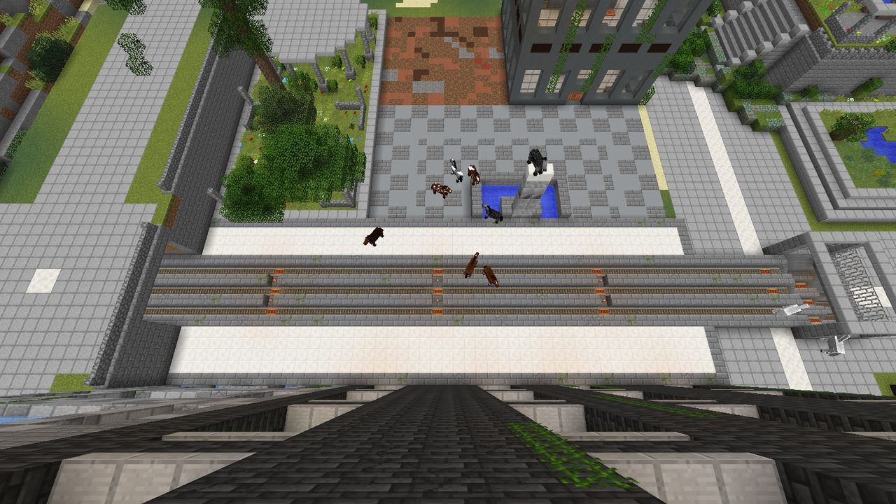
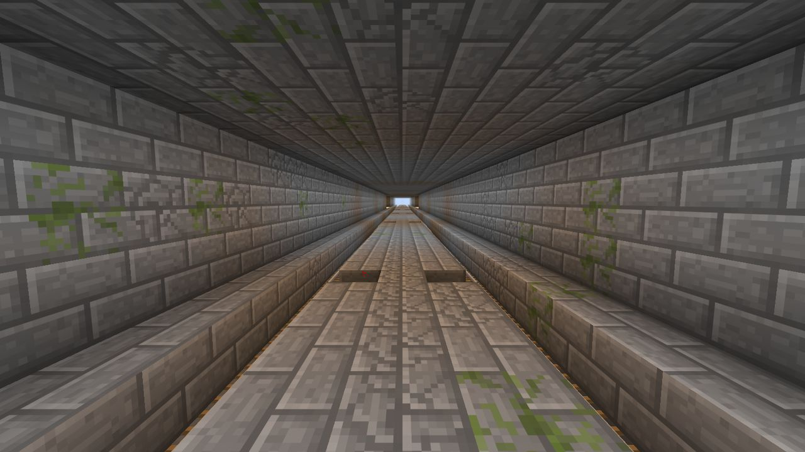
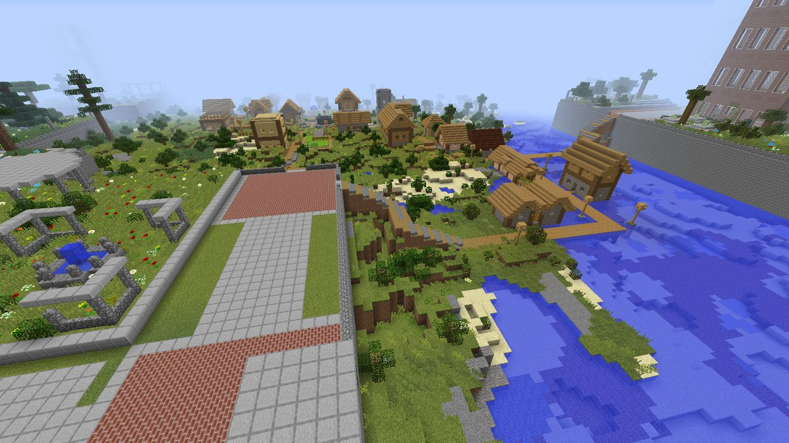

# Lost Cities: New Horizons

Abandoned cities for the **GT New Horizons** overworld (Minecraft 1.7.10). This is a backport of McJty's [Lost Cities](https://github.com/McJtyMods/LostCities), built for GTNH 2.9.0 and its Realistic World Gen terrain.

Explore cities that were here before you, salvage what they left behind, or move into a block of buildings and build your base inside it.

> [!NOTE]
> **Beta (0.1.0-beta).** The whole mod is in, unpolished: this build is for playtesting. Balance (loot, spawners, city size and density) is tuned during this beta review, against the [balance list](docs/new-spec/beta-balance-list.md); the [known limits](#known-limits) below are real. Use a new world.

## What it does

- **Lost Cities, faithfully.** Upstream Lost Cities' cities, generated in the overworld: buildings floor by floor with cellars, doors and stairwells; streets, plazas, parks, fountains and bridges; ruined buildings, explosion craters and rubble, with some damage patched up. All 322 of upstream's buildings, parts, palettes and styles are bundled.
- **Over RWG terrain.** Cities are set into the pack's RWG2 Continents and classic RWG landscapes. A city levels its own ground, slopes down into the land around it, and stops before mountains instead of climbing them. Building heights taper from a high-rise core to low buildings, empty lots and construction sites at the edge.
- **Built from the pack's blocks.** Walls, trims, glass, floors, ceilings, lights, furniture and park flowers come from GTNH's decorative blocks (Chisel, Railcraft, Et Futurum, Botania, Ztones, Tinkers', Thaumcraft, GregTech and more), each building its own mix. Neighboring buildings' colors stay in harmony. Desert cities are pale and muted.
- **GTNH loot, at EV or below.** City chests hold GT components, circuits and materials, pack food and supplies, and the pack's loot bags, in tier bands from Stone to EV; EV only rarely, on high floors and in deep cellars. Rail dungeons hold Railcraft gear. Spawners use upstream's mobs. GT ore veins run through cities untouched.
- **Good neighbors.** Cities build around VillageNames villages (sewn in as an old town, with lanes to their gates), ocean monuments, Roguelike Dungeons towers, Witchery structures, LootGames dungeons, AE2 meteorites and RWG2's volcanoes and lava caves. Lakes, lava lakes, dungeons and oil deposits keep out of cities.
- **Scattered structures.** Cabins and radio towers stand in the countryside between cities, and oil rigs in RWG2's deep ocean.
- **Profiles.** Ten built-in profiles (`default`, `nodamage`, `rarecities`, `onlycities`, `tallbuildings`, `safe`, `ancient`, `wasteland`, `atlantis`, `largecities`), and your own in upstream's JSON format.
- **For server owners and builders:** operator commands to inspect and locate cities and buildings, a part editor for making new buildings, and an [API](docs/api.md) for other mods.

## Screenshots

All taken in a GTNH 2.9.0 world on RWG2 Continents with the default settings.


*A city's skyline over RWG terrain: tall towers in the core taper to low buildings at the edge.*


*Where a city meets the overworld: streets and parks end at the forest.*


*An elevated highway deck running between towers, with gantries and street lights.*


*A surface railway station with its platforms, tracks and forecourt.*


*A railway line seen from inside its tunnel.*


*A village sewn into the city's edge, next to a paved plaza and a river.*

## Requirements

- **GT New Horizons 2.9.0**, server and client. The pack provides GTNHLib, the one hard dependency.
- An overworld of type **RWG2 Continents**, **RWG2**, **classic RWG** or **flat**. Other world types get no cities.

## Installing

The same jar goes on the server and on every client: a server running the mod turns away clients without it.

### Dedicated server

1. Stop the server and put `lostcitiesnh-<version>.jar` in `mods/`.
2. Choose the world type in `server.properties` **before the world is created**. The GTNH 2.9.0 server pack ships `level-type=rwg`, which is classic RWG. For RWG2 Continents, set `level-type=RWG2_CONTINENTS`.
3. Optionally choose a profile (below).
4. Start the server with a **new world** (delete or rename the old `world/` folder, or set `level-name` to a new name). Cities appear from the first chunk.

### Client

Put the same `lostcitiesnh-<version>.jar` in the instance's `mods/` folder. For single player, create a new world: the pack's create-world screen defaults to RWG2 Continents.

### Existing worlds

A world created before the mod was installed gets no cities, so its terrain is never cut in half. To add cities to one anyway, an operator stands in it and runs `/lostcities profile pin default confirm`, or a server owner sets `enableOnExistingWorlds=true` before its next start. Chunks generated before do not change, so new city chunks will not meet them cleanly at the border.

## Choosing a profile

A world takes its profile when it is created and keeps it; changing the config later does not change a world that exists.

- **Dedicated server:** in `config/lostcitiesnh.cfg`, set `dimensionProfiles` to `0=<profile>`, for example `0=rarecities`, before creating the world.
- **Single player:** in the main menu, open **Mods**, select Lost Cities: New Horizons, press **Config**, open **Profiles** and edit **Dimension profiles**. The next world you create uses it.
- **Your own profile:** `/lostcities saveprofile default mine` writes `config/lostcitiesnh/profiles/mine.json` with every option. Edit it, run `/lostcities profile reload`, and name it in `dimensionProfiles`.

`/lostcities profile` shows the profile the world you stand in was created with; `/lostcities profile list` lists every profile. Every option and config key is documented in [docs/config.md](docs/config.md).

## Commands

All need operator level 2. `/lost` and `/lostcitiesnh` are aliases of `/lostcities`.

| Command | What it does |
|---|---|
| `/lostcities profile [list \| info <profile> \| reload \| pin <profile> confirm]` | Show, list, inspect, reload or pin profiles |
| `/lostcities saveprofile <profile> <newName>` | Copy a profile to a file you can edit |
| `/lostcities locate <building>` | The nearest places a building stands, from the plan, without generating anything |
| `/lostcities debug [<x> <z>]` and `/lostcities map [<x> <z>]` | The layout of a chunk, and a 41 × 41-chunk map of cities and landmarks around it, to the server log. `<x> <z>` are block coordinates; without them the sender's position is used. From the server console, or `execute` without coordinates, they print usage |
| `/lostcities timers` (or `timings`) | World generation timings |
| `/lostcities createbuilding <building> <floors> <cellars> <x> <y> <z>` | Build a building at a position |
| `listparts`, `locatepart`, `editpart`, `resumeedit`, `createpart`, `exportpart` | The part editor, in a world created with the `editMode` profile option; exports go to `config/lostcitiesnh/export/parts/` |

## Upgrading from an alpha build

Start a **new world** for the beta. Alpha-era worlds keep their profile, but this build generates cities differently: the city layout version is now 4 (alpha worlds were made with 1 to 3), and desert cities' facades and the palette variety changed. New chunks next to old ones will show seams: a street that stops, a building cut in half, a cliff. The server logs one warning per dimension when this applies (`was pinned with layout version …: new chunks may not match`, and a list of changed asset files). Nothing breaks, and no item or block was removed: the mod registers no blocks or items, so an alpha world still loads.

## Known limits

- **Overworld only, on RWG or flat.** Upstream's floating, space, cavern and sphere landscapes and their profiles, and the separate Lost City dimension, are not included, nor the monorails only the space landscape builds (D12).
- **No world-preset screen.** Profiles are chosen in the config, as above.
- **World generation cost.** With every city-realism default on, city generation adds about 11.5 % to RWG's own generation time over a large region on RWG2 Continents (seed 4242) and about 8 % on classic RWG (seed 777). All five time budgets hold on both, with no chunk's overlay work above 10 ms at p99.9 (measured in [0005 §8](docs/design/0005-rwg-overlay.md#8-time-budget-and-how-it-is-measured-q10)).
- **Older worlds look older.** Worlds pinned before the city-realism options keep the old generation (6-block floors, single-chunk lots, no pack houses or furniture). In such a world a highway that turns where a neighboring route ramps can still be cut by a tunnel wall; new worlds have the fixes (`rampSurface`, `railwayCoreEnds`, `highwayRampHolds`). Re-pin with `/lostcities profile pin <profile> confirm` to opt in, accepting seams at the edge of explored land.
- **No achievements or in-game guide yet.**

Report what you find to the mod's issue tracker with the seed, world type, profile and coordinates (`/lostcities debug` at the spot helps).

## Building from source

```sh
./gradlew build        # the jar is in build/libs/
./gradlew runClient    # development client
```

Contributors start with [CONTRIBUTING.md](CONTRIBUTING.md). The roadmap is in [docs/ROADMAP.md](docs/ROADMAP.md), the design records in [docs/design/](docs/design/README.md), and the behavior spec in [docs/original-spec/](docs/original-spec/README.md) and [docs/new-spec/](docs/new-spec/README.md).

## License

MIT; see [LICENSE](LICENSE). Lost Cities is © 2017 McJty, under the MIT License; see [THIRD-PARTY-NOTICES.md](THIRD-PARTY-NOTICES.md).
